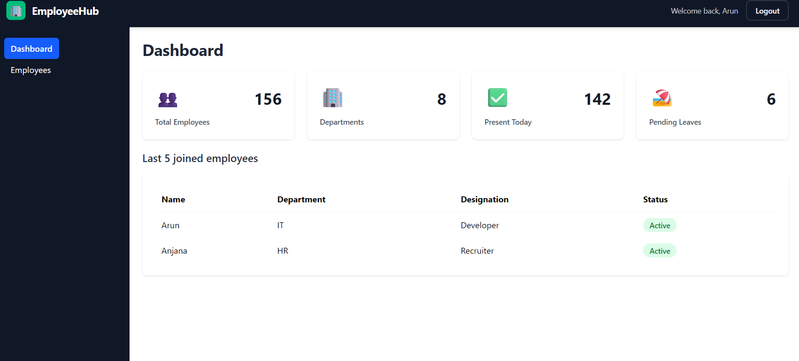
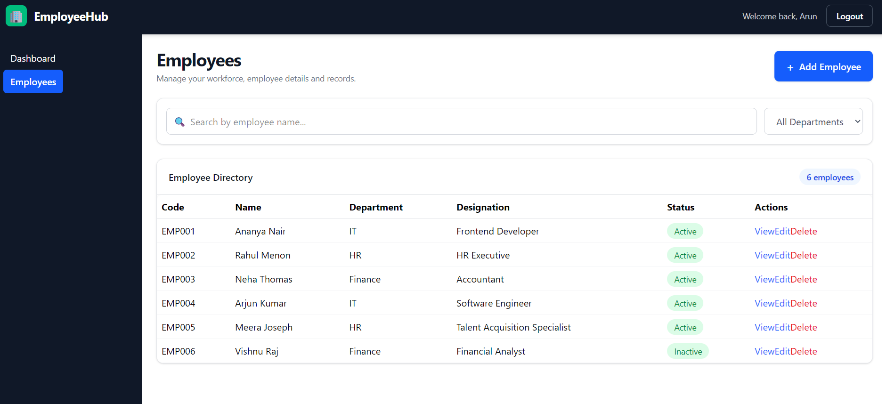
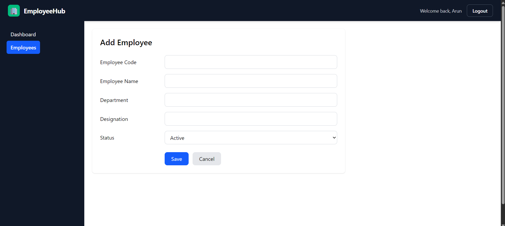
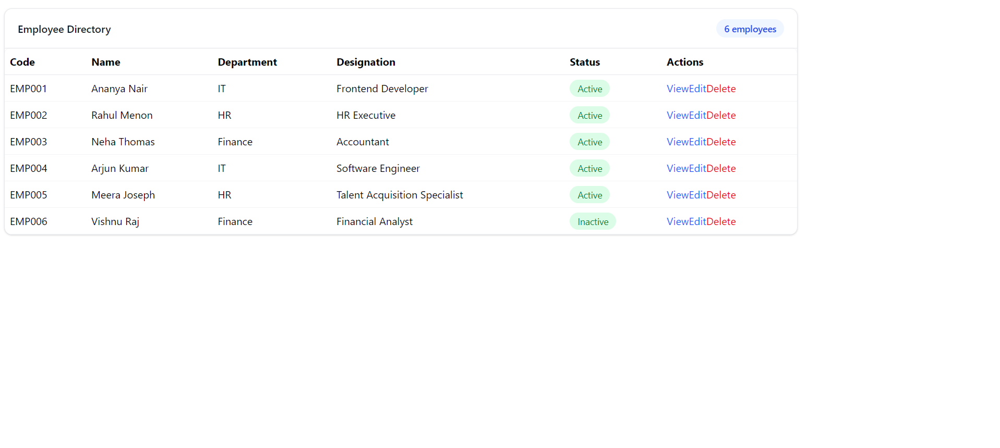
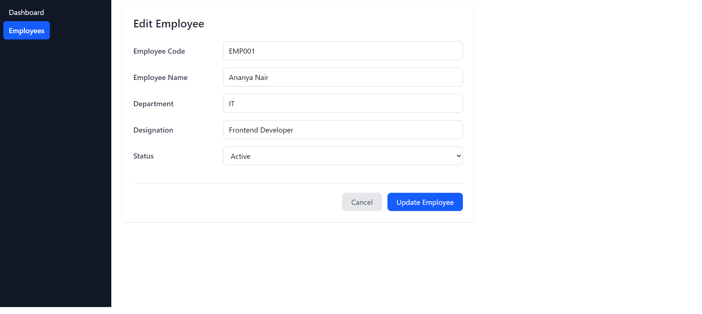

# EmployeeHub HRMS — Employee Management System

A modern, responsive Employee Management System built with **React, Vite, and Tailwind CSS**, featuring employee CRUD operations, REST API integration, form validation, protected routes, and a dashboard.

<p align="center">
  <a href="https://employee-mangement-system-eta.vercel.app/">
    <strong>🚀 Live Demo</strong>
  </a>
  &nbsp; · &nbsp;
  <a href="https://employee-mangement-system-uwav.onrender.com/employees">
    <strong>🔌 Live API</strong>
  </a>
</p>

---

## 🚀 Live Application

| Resource | Link |
|---|---|
| 🌐 Live Frontend | [EmployeeHub on Vercel](https://employee-mangement-system-eta.vercel.app/) |
| 🔌 Employee REST API | [View Employee Data](https://employee-mangement-system-uwav.onrender.com/employees) |
| 🖥️ Frontend Hosting | Vercel |
| ☁️ API Hosting | Render |

---

## 📸 Screenshots

### 🏠 Dashboard



### 👥 Employee Management



### ➕ Add Employee



### 📋 Employee Details



### ✏️ Edit Employee



---

## ✨ Features

- **Dashboard:** Employee statistics and department overview.
- **Employee Management:** View and manage employee records.
- **Create Employees:** Add employee records through a validated form.
- **Edit Employees:** Update existing employee information.
- **Employee Details:** View individual employee information.
- **Search & Filtering:** Search employee records and filter by department.
- **REST API Integration:** Communicate with the API using Axios.
- **Form Validation:** React Hook Form and Zod.
- **Protected Routes:** Client-side route protection using React Context.
- **Loading, Error & Empty States:** Handle different API states.
- **Success Feedback:** Display confirmation after successfully adding an employee.
- **Delete Confirmation:** Confirm before deleting employee records.
- **Responsive UI:** Layout and styling using Tailwind CSS.

---

## 🛠️ Tech Stack

| Technology | Purpose |
|---|---|
| React | Component-based UI development |
| Vite | Development server and build tooling |
| Tailwind CSS | Responsive styling |
| React Router | Client-side routing |
| Axios | HTTP requests and API integration |
| React Hook Form | Form state management |
| Zod | Schema-based form validation |
| JSON Server | Mock REST API |
| Git & GitHub | Version control |
| Vercel | Frontend deployment |
| Render | API deployment |

---

## 🏗️ Project Architecture

The application separates pages, reusable components, authentication logic, and API communication to keep the code organized and maintainable.

```text
src/
├── components/
│   ├── Layout/
│   ├── Navbar/
│   ├── Sidebar/
│   └── EmployeeTable/
├── context/
│   ├── contextStore.js
│   ├── AuthContext.jsx
│   ├── useAuth.js
│   └── ProtectedRoute.jsx
├── pages/
│   ├── Login.jsx
│   ├── Dashboard.jsx
│   ├── Employees.jsx
│   ├── AddEmployee.jsx
│   └── EmployeeDetails.jsx
├── services/
│   ├── axiosClient.js
│   └── employeeService.js
├── App.jsx
└── main.jsx

db.json
```

*This is a high-level overview. Refer to the repository for the complete implementation and actual file structure.*

---

## 🔌 REST API

The frontend uses Axios and a dedicated employee service layer to communicate with JSON Server.

**Base URL:** `https://employee-mangement-system-uwav.onrender.com`

| Method | Endpoint | Description |
|---|---|---|
| GET | `/employees` | Retrieve all employees |
| GET | `/employees/:id` | Retrieve an employee by ID |
| POST | `/employees` | Create a new employee |
| PUT | `/employees/:id` | Update an employee |
| DELETE | `/employees/:id` | Delete an employee |

---

## ⚙️ Run Locally

### Prerequisites

- Node.js and npm
- Git

### Installation

**1. Clone the repository**

```bash
git clone https://github.com/arun-devs/Employee-Mangement-System.git
```

**2. Navigate to the project folder**

```bash
cd Employee-Mangement-System
```

**3. Install dependencies**

```bash
npm install
```

**4. Start the frontend**

```bash
npm run dev
```

**5. Start the JSON Server in a separate terminal**

```bash
npm run server
```

Ensure the Axios base URL points to your local JSON Server when running locally.

---

## 🔐 Authentication

EmployeeHub demonstrates a client-side authentication flow using React Context API and protected routes.

- Clicking the login button allows access to protected pages.
- Email and password credentials are not verified.
- Unauthenticated users are redirected to the login page when accessing protected routes.
- Logging out clears the client-side authentication state.
- Authentication state is stored in memory and resets after a page refresh.

**Note:** This is a demonstration of frontend authentication flow, not a secure production authentication system. Server-side credential verification, authorization, and persistent sessions are not implemented.

---

## ⚠️ Current Limitations

- JSON Server is used instead of a custom Node.js/Express backend.
- Employee data is stored in `db.json`, not a production database.
- The hosted Render service does not have persistent disk storage configured, so runtime data changes may be lost after a restart or redeployment.
- Attendance and pending-leave dashboard figures are demonstration values, not calculated from dedicated attendance or leave records.
- Authentication is client-side only.

---

## 🔮 Future Improvements

- Implement secure authentication and role-based authorization.
- Build a custom backend using Node.js and Express.
- Integrate a persistent database.
- Add attendance and leave management modules.
- Add automated tests.
- Implement pagination and sorting for larger employee datasets.

---

## 👨‍💻 About

EmployeeHub is a portfolio project demonstrating practical frontend engineering skills, including component-based architecture, routing, API integration, form validation, state management, and deployment.

---

<p align="center">
  <strong>EmployeeHub HRMS</strong><br/>
  Built with React, Vite, and Tailwind CSS.
</p>
